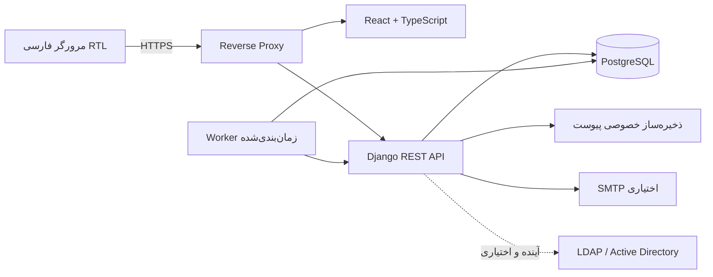

<!--
  - SPDX-FileCopyrightText: 2026 Nextcloud GmbH and Nextcloud contributors
  - SPDX-License-Identifier: AGPL-3.0-or-later
-->
# معماری پیشنهادی

## اصول

محصول یک سامانه مستقل و اصیل برای هلدینگ زکریا شیمی است؛ Nextcloud تنها منبع نیازمندی تاریخی است و هیچ کد، کلاس، API، دارایی بصری، نام‌گذاری داخلی یا اتصال اجباری آن منتقل نمی‌شود. دامنهٔ اولیه «مدیریت مرخصی و غیبت» است، نه HRMS یا payroll.

## نمای کلان

## اجزای منطقی

- **هویت و سازمان:** حساب داخلی، نقش‌های متعدد، شرکت/واحد/سمت، مدیر و وضعیت استخدام؛ adapter برای LDAP در مرحله جداگانه.
- **هسته دامنه:** درخواست، ماشین وضعیت، سیاست نوع مرخصی، پوشش و قواعد مالکیت؛ انتقال وضعیت فقط از سرویس دامنه.
- **سهمیه:** ثبت دفترکل تغییرات و محاسبهٔ استفاده/انتظار در تراکنش؛ نه منطق تکراری در API یا UI.
- **تقویم و تاریخ:** ذخیره تاریخ استاندارد ISO، مبدل شمسی مرکزی، تعطیلات نسخه‌دار و سرویس محاسبهٔ تخمینی؛ مقدار تأییدشده هرگز بی‌صدا باز‌محاسبه نمی‌شود.
- **گزارش/خروجی:** queryهای محدود به scope مجاز، خروجی CSV/XLSX و خنثی‌سازی formula injection.
- **اعلان/حسابرسی:** اعلان درون‌سامانه، SMTP اختیاری، رویدادهای درخواست و Audit مستقل با حداقل داده حساس.
- **عملیات:** management commandهای idempotent برای یادآوری، ارجاع و انتقال مانده؛ اجرای Worker جدا از API.

## پشته و استقرار

- Backend: Python، Django و Django REST Framework؛ API زیر `/api/v1` و OpenAPI.
- Frontend: React و TypeScript، RTL و فارسی.
- داده: PostgreSQL با foreign key، unique/check constraints، index و migration نسخه‌بندی‌شده.
- استقرار: Docker Compose برای توسعه و استقرار اولیه؛ Reverse Proxy برای TLS. نسخه‌های وابستگی باید هنگام پیاده‌سازی از رجیستری معتبر بررسی و lock شوند.
- ابتدا Worker سادهٔ مستقل/زمان‌بندی‌شده و قفل دیتابیسی بررسی شود؛ Redis تنها وقتی نیاز صف، cache یا هماهنگی چند Worker اثبات شد اضافه شود. Celery/Redis فعلاً تصمیم قطعی نیست.
- فایل‌ها در volume خصوصی یا object store خصوصی نگه‌داری می‌شوند؛ دانلود فقط از مسیر مجوزدار برنامه.

## مرزهای اعتماد

مرورگر غیرقابل‌اعتماد است؛ همه نقش‌ها، scope شرکتی، محرمانگی، اعتبار تاریخ، وضعیت درخواست و مجوز پیوست در Backend دوباره بررسی می‌شود. API و Worker از یک سرویس دامنه استفاده می‌کنند. ایمیل و LDAP مرزهای بیرونی و اختیاری‌اند؛ قطع آن‌ها نباید عملیات اصلی حساب داخلی یا اعلان داخلی را از کار بیندازد.

## تصمیم‌های مشروط

1. modular monolith برای MVP؛ microservice توجیه ندارد.
2. احراز هویت داخلی، cookie امن و CSRF در same-origin به‌عنوان خط پایه؛ جزئیات چرخش نشست در threat model تثبیت می‌شود.
3. روز کاری واردشده/تأییدشده منبع محاسبه مانده است؛ تخمین تقویمی صرفاً راهنماست.
4. تاریخ شمسی فقط قالب نمایش/ورودی است؛ تاریخ ذخیره‌سازی و قرارداد API استاندارد و قابل‌مقایسه می‌ماند.
5. هیچ قانون سهمیه، تعطیلی یا نگهداری داده بدون تصویب مالک سازمانی پیش‌فرض نمی‌شود.

این معماری تغییر هدف مخزن فعلی از افزونه Nextcloud به سامانه مستقل است. طبق AGENTS.md این تغییر چندزیرسامانه‌ای نیازمند تیکت/هم‌راستاسازی نگه‌دارندگان پیش از کدنویسی اجرایی است.