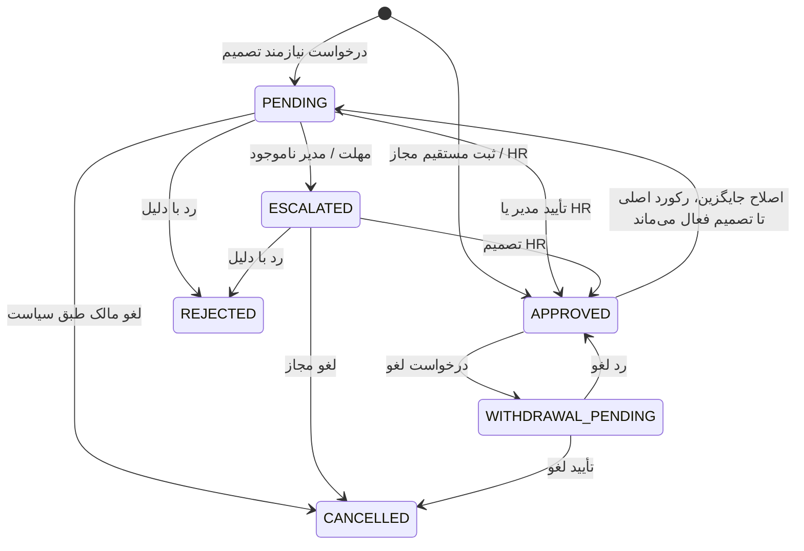

<!--
  - SPDX-FileCopyrightText: 2026 Nextcloud GmbH and Nextcloud contributors
  - SPDX-License-Identifier: AGPL-3.0-or-later
-->
# گردش کار و ماشین وضعیت

## وضعیت‌های پایه

`PENDING`، `ESCALATED`، `APPROVED`، `REJECTED`، `CANCELLED` و `WITHDRAWAL_PENDING`. تغییر وضعیت فقط از سرویس دامنه و داخل تراکنش مجاز است.

## قواعد انتقال

| از | عمل/عامل | به | شرط و اثر |
|---|---|---|---|
| شروع | کارمند ثبت | PENDING | نوع قابل درخواست، تاریخ/روز معتبر، مدیر resolve شده |
| شروع | HR ثبت به نیابت | APPROVED | HR scope، نوع مجاز و actor ثبت شود |
| شروع | نوع بدون approval | APPROVED | فقط اگر policy نوع صریحاً اجازه دهد |
| شروع | مدیر وجود ندارد | ESCALATED | HR مقصد، تاریخچه علت |
| PENDING/ESCALATED | مدیر/HR تأیید | APPROVED | مجوز جاری، قفل و اعتبارسنجی مجدد |
| PENDING/ESCALATED | مدیر/HR رد | REJECTED | دلیل غیرخالی و ممیزی |
| PENDING | کارمند لغو | CANCELLED | مالک و سیاست اجازه؛ release رزرو روزها |
| PENDING | worker ارجاع | ESCALATED | مهلت گذشته؛ conditional update اتمیک |
| APPROVED | کارمند درخواست لغو | WITHDRAWAL_PENDING | درخواست اصلی تا تصمیم همچنان در مصرف مانده است |
| WITHDRAWAL_PENDING | مدیر/HR پذیرفتن لغو | CANCELLED | بازگرداندن روزها دقیقاً یک‌بار |
| WITHDRAWAL_PENDING | مدیر/HR رد لغو | APPROVED | مانده بدون تغییر |
| APPROVED | کارمند اصلاح | درخواست superseding جداگانه | یک اصلاح فعال؛ اصلی تا تأیید معتبر می‌ماند |

## اعتبارسنجی و ترتیب عملیات

1. احراز هویت و مجوز و scope شرکت بررسی شود.
2. رکورد با `select_for_update`/قفل سازگار خوانده شود؛ state و نسخه دوباره بررسی شوند.
3. قواعد دامنه، هم‌پوشانی، نوع و مانده در تراکنش بررسی شوند.
4. درخواست/دفترکل/رویداد حسابرسی و outbox اعلان در یک commit نوشته شوند.
5. ایمیل و اعلان پس از commit ارسال و نتیجه delivery جدا ثبت شود؛ retry رویداد تکراری نسازد.

روز کاری واردشده مرجع نهایی است. سیستم می‌تواند تخمین نمایش دهد، اما مقدار را پس از تأیید خودکار تغییر نمی‌دهد. منفی شدن مانده تا تصویب سیاست فقط هشدار است، نه منع پیش‌فرض. درخواست گذشته‌نگر برای کارمند و HR نیازمند سیاست متمایز و تأیید است.

در برش فعلی، کارمند نمی‌تواند درخواست با تاریخ شروع گذشته ثبت کند؛ تاریخ امروز براساس timezone شرکت است. HR مجاز به ثبت گذشته‌نگر است. تا تصویب نحوهٔ تخصیص تعداد روزهای کاری بین سال‌ها، بازه‌ای که از مرز سال می‌گذرد رد می‌شود و باید به دو درخواست تقسیم شود؛ سیستم مانده را بی‌صدا به سال شروع منتسب نمی‌کند.

## محاسبه مانده

- کل = پایه + انتقال + مجموع اصلاحات دفترکل.
- استفاده‌شده = مجموع درخواست‌های APPROVED که نوع آن‌ها از سهمیه کم می‌کند.
- در انتظار = رزرو وضعیت‌های PENDING/ESCALATED و اصلاحات در حال تصمیم، بدون شمارش دوگانه رکورد اصلی.
- باقی‌مانده = کل − استفاده‌شده؛ قابل استفاده = کل − استفاده‌شده − در انتظار.
- رد/لغو هیچ اثری بر مصرف ندارد؛ لغو تأییدشده مصرف را یک‌بار آزاد می‌کند.
- تخصیص روزهای عبوری از سال تا تصمیم HR پیکربندی/تصویب نشود، نباید با فرض پنهان انجام شود.

## Jobها

یادآوری، ارجاع و rollover با کلید idempotency، قفل/conditional update، ثبت `JobExecution` و retry محدود اجرا می‌شوند. rollback یا شکست اعلان نباید انتقال وضعیت را دوباره اجرا کند. region/timezone، تفاوت روز کاری و تقویمی و ساعات اجرای Job نیازمند policy مصوب است.